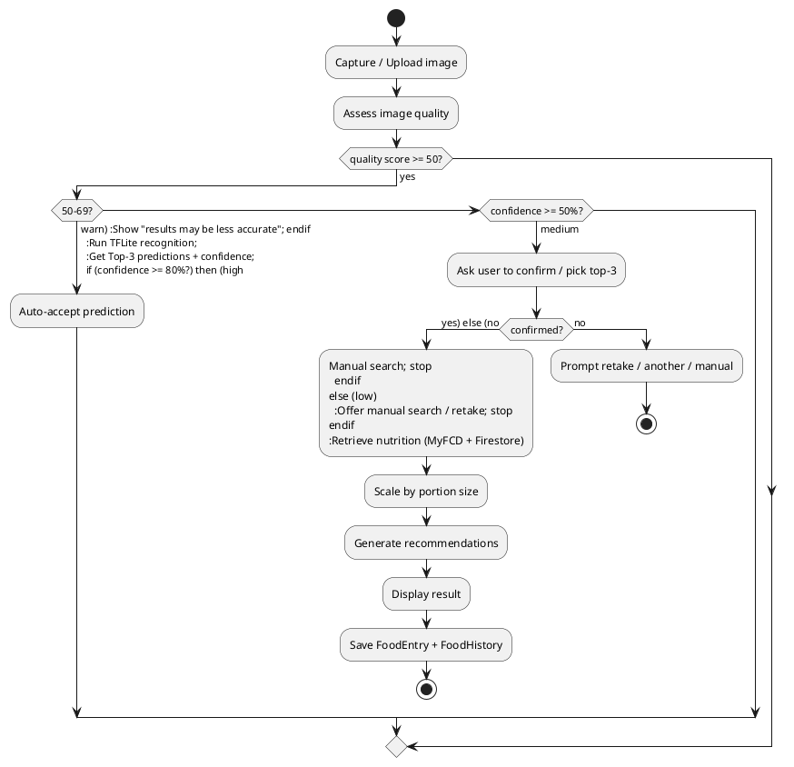
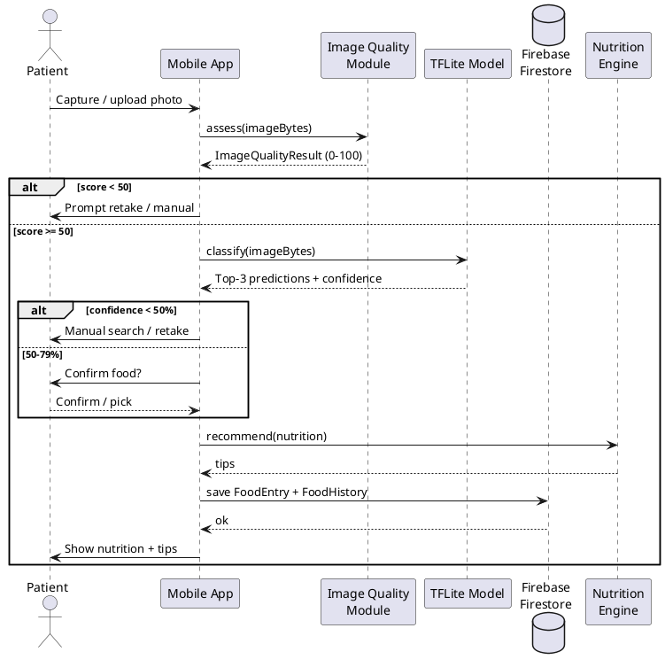

# SmartBunda — Food Image Recognition & Nutrition Analysis Module (Design)

FYP design documentation for the hardened food-analysis module: image quality
assessment (IQA), confidence-gated recognition, nutrition retrieval, a
recommendation engine, and analysis history. Implemented in **Flutter (Dart)**
with **Firebase** + **TensorFlow Lite**, following MVVM + repository patterns.

---

## 1. System workflow

```
Capture / Upload image
  → Image Quality Assessment (blur, brightness, contrast, resolution → 0–100)
      • score < 50  → block: Retake / Choose another / Search manually / Use anyway
      • 50–69       → warn "results may be less accurate", continue
      • ≥ 70        → continue
  → TFLite recognition (top-3/5 predictions + confidence)
  → Confidence validation
      • ≥ 0.80 → auto-accept
      • 0.50–0.79 → user confirms (or picks from top-3) before nutrition
      • < 0.50 → no nutrition; search manually / browse / retake
  → Nutrition retrieval (MyFCD offline + Firestore Foods) + portion scaling
  → Recommendation generation (rules over nutrition values)
  → Result display + save (FoodEntry) + FoodHistory record
```

## 2. Architecture (MVVM + Repository)

| Layer | Responsibility | Files |
|-------|----------------|-------|
| **View** | Capture, quality badge, gating UI, nutrition, tips, history | `screens/food/food_scan_screen.dart`, `food_analysis_result_screen.dart`, `food_history_screen.dart`; `screens/log/meal_log_actions.dart` |
| **ViewModel/State** | Riverpod providers + screen state | `providers/app_providers.dart` (`foodHistoryProvider`), `services/service_providers.dart` |
| **Service** | IQA, TFLite inference, recommendation engine | `services/image_quality_service.dart`, `services/food_image_classifier_native.dart`, `utils/nutrition_recommendations.dart` |
| **Repository** | Firestore persistence | `services/food_history_repository.dart`, `services/firestore_data_store.dart` |
| **Model** | Data classes | `models/food_history_entry.dart`, `models/food_entry.dart`, `utils/food_nutrition_lookup.dart` |

### Class responsibilities
- **`ImageQualityService`** — `assess(bytes) → ImageQualityResult{score, level,
  blur/brightness/contrast sub-scores, resolutionOk, reason}`. Laplacian-variance
  blur, mean-luminance brightness, stddev contrast, dimension check; runs in a
  background isolate (`compute`).
- **`FoodImageClassifier`** — TFLite preprocessing + inference → ranked
  `FoodImagePrediction{label, confidence}`.
- **`NutritionRecommendations.recommend(FoodNutritionData)`** — pure rules →
  `List<NutritionTip>` (high sugar/sodium, low/high protein, fibre, iron, energy).
- **`FoodHistoryRepository`** — `watchHistory(patientId)`, `add(entry)` on
  Firestore `FoodHistory`.

## 3. Confidence & quality thresholds

| Quality score | Action |
|---------------|--------|
| ≥ 70 (Good) | proceed silently |
| 50–69 (Fair) | warn, allow continue |
| < 50 (Poor) | block; retake / another / manual / use-anyway |

| Recognition confidence | Action |
|------------------------|--------|
| ≥ 80% | auto-accept, show nutrition |
| 50–79% | confirm (or pick top-3) → then nutrition |
| < 50% | no nutrition; manual search / retake |

## 4. Firestore structure

```
Foods/{foodId}
  foodName, category, calories, protein, carbohydrates, fat, fiber, sugar,
  sodium, calcium, iron, vitaminA, vitaminC, vitaminD, imageUrl

FoodHistory/{historyId}
  historyId, patientId, foodName, confidenceScore (0–100),
  qualityScore (0–100), calories, analysisDate (ISO8601), imageUrl?
```
Composite index: `FoodHistory (patientId ASC, analysisDate DESC)` — added to
`firestore.indexes.json`. Security: a patient reads/writes only their own
history (see `firestore.rules`).

## 5. Activity diagram (PlantUML)



## 6. Sequence diagram (PlantUML)



## 7. Error handling

| Failure | Handling |
|---------|----------|
| Invalid/empty image | `ImageQualityResult.invalid` → "Could not read image" |
| Camera permission denied | caught at `pickImage`; user-facing snackbar |
| TFLite load/inference failure | `FoodImageClassifierException.userMessage` |
| Low quality | blocking dialog with retake/manual options |
| Low confidence | nutrition withheld; manual/retake offered |
| Firestore failure (history) | best-effort; save flow not blocked |
| Missing nutrition record | nutrition shown as unavailable; no fabrication |

## 8. Best practices applied
- IQA + confidence **gating** instead of blind classification (handles blurry/low-light).
- **No fabricated nutrition** when confidence/quality is low.
- Background isolate for IQA; image downscaled for the pixel math (mid-range perf).
- Reuse of existing capture/TFLite/portion/nutrition code; additive, non-breaking.
- Theme-aware Material Design 3 UI (light/dark).
- History stored for future model improvement and object-detection/ingredient
  analysis extensions.
